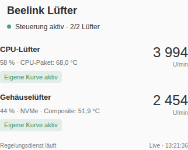
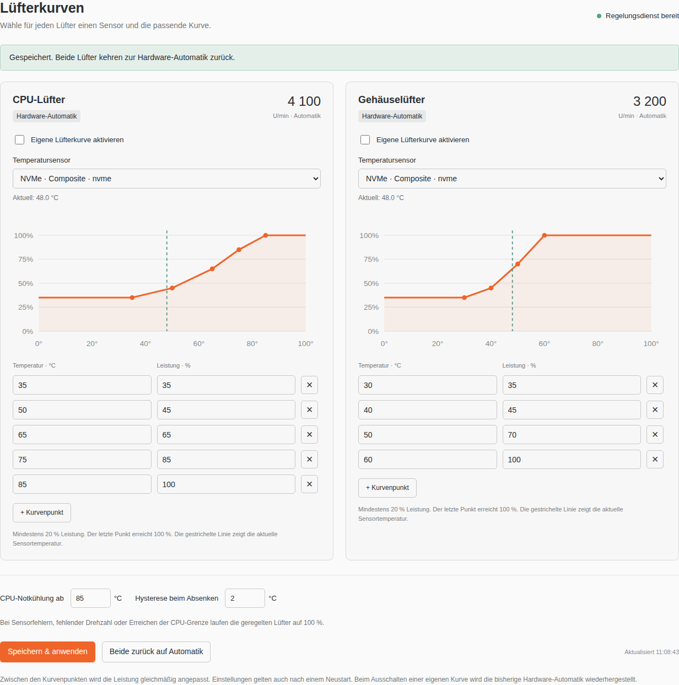

# Beelink Fan Control for Unraid

Per-fan temperature curves and a live Unraid dashboard tile for the **Beelink
EQ12**, with an **AZW EQ board and ITE IT8613E** fan controller.



## Features

- Separate curves for the CPU fan and case fan, each with its own hwmon
  temperature sensor.
- Two to ten curve points, linear interpolation and 20–100% PWM duty.
- Live RPM, selected sensor temperature, PWM duty and curve preview.
- Dashboard tile with actual control mode, service status and protection
  indicators. Readings refresh every five seconds.
- Cooling hysteresis and an independent CPU-temperature override, even when
  a fan follows an NVMe or motherboard sensor.
- Full speed on unavailable temperature data or a missing/stalled fan signal.
- A separate watchdog restores the original hardware automatic control after
  an unexpected controller exit or a missed heartbeat.
- Persistent settings and a self-contained, offline-installable plugin package.

The interface is currently in German. On first installation both custom curves
are disabled, so the existing hardware automatic control stays active.

## Requirements

- Unraid **7.2.4 or newer**. Hardware validation was performed on Unraid 7.2.4.
- **Python 3.9+ available at `/usr/bin/python3`**, including after boot. On
  Unraid this can be provided by NerdTools.
- The [IT87 Driver plugin](https://github.com/ich777/unraid-it87-driver), using
  a driver package that matches the running Unraid kernel and supports IT8613E.
- A working `coretemp` CPU-package sensor.

This plugin does not bundle a kernel driver. The stock driver may not support
IT8613E. The driver plugin supplies the matching out-of-tree module from
[frankcrawford/it87](https://github.com/frankcrawford/it87).

Fan mapping on the supported EQ12:

| Fan | RPM input | PWM channel |
| --- | --- | --- |
| CPU | `fan2_input` | `pwm2` |
| Case | `fan3_input` | `pwm3` |

Control is restricted to the AZW EQ board. Other Beelink models and different
fan mappings have not been validated.

## Install

In Unraid, open **Plugins → Install Plugin** and paste:

```text
https://raw.githubusercontent.com/maisi/unraid-beelink-fan-control/main/dist/beelink-fan-control.plg
```

Alternatively, from an Unraid root terminal:

```bash
plugin install https://raw.githubusercontent.com/maisi/unraid-beelink-fan-control/main/dist/beelink-fan-control.plg
```

Open **Settings → User Utilities → Beelink Lüfter**, or `/Settings/BeelinkFans`,
to select sensors, edit curves and enable each fan separately. The dashboard
tile's gear icon opens the same page.

The `.plg` includes the application package and verifies its SHA256. Once it
has been saved to the USB flash device, restoring the application at boot
does not require downloading that package again. The driver has its own
kernel-version and download requirements.



## Settings and updates

Configuration is saved atomically to:

```text
/boot/config/plugins/beelink-fan-control/config.json
```

Runtime status and process files stay in RAM under
`/var/run/beelink-fan-control/`. Only saving settings writes configuration to
the flash device. Sensor IDs use the chip, device path and channel rather than
an unstable `hwmon` number.

The plugin includes its public update URL for Unraid's plugin manager. Display
updates leave the controller running when its code is unchanged. Controller
updates stop it cleanly, restore hardware automatic mode and restart with the
existing settings.

Service commands:

```bash
/etc/rc.d/rc.beelink-fan-control status
/etc/rc.d/rc.beelink-fan-control stop
/etc/rc.d/rc.beelink-fan-control start
```

The controller starts during plugin installation and does not require the
array to be running. Starting the array also checks that the service is
running. Normal shutdown signals trigger restoration of hardware automatic
control. A full reboot/kernel-upgrade test has not yet been performed.

## Control and protection

The controller polls every two seconds. Defaults are a 2 °C cooling hysteresis
and full speed at a CPU package temperature of 85 °C. CPU protection applies
independently of the temperature sensor selected for each fan.

Manual PWM duty and `pwmN_auto_start` share a register on IT8613E. Returning
only to automatic mode would leave its start value changed. This plugin saves
and restores **both the mode and original automatic start value**.

An independent watchdog shares the hardware lock, restores the saved values
on controller death, and handles a ten-second heartbeat timeout. The lock
also coordinates with the earlier `beelink-fan` helper. Other fan-control
plugins should not control the same PWM channels simultaneously.

The 20% lower limit is not a measured fan-start threshold for every unit. If
RPM is unavailable or below 200 after an eight-second startup period, the
controlled fan goes to full speed. Low-duty curves still need to be tuned for
the actual hardware. See [validation and limits](docs/testing.md).

## Build and test

Python and the runtime application use the standard library only. Node.js and
Playwright are development dependencies for the simulated browser tests.

```bash
python3 -m unittest -v
npm ci
npx playwright install chromium
npm run check
npm test
python3 build.py
```

Linux hosts may need `npx playwright install --with-deps chromium`. An existing
Chromium executable can be selected with `BEELINK_CHROMIUM_EXECUTABLE`.

The builder writes `dist/beelink-fan-control.plg` and its embedded `.txz`
package. The tracked plugin is reproducibly built from the source. Browser
test screenshots go to the ignored `artifacts/` directory. All automated
tests use temporary files or simulated sensor data, not a live machine.

## Monitoring

The IT8613E driver exposes RPM through standard hwmon files. Prometheus Node
Exporter can export them as `node_hwmon_fan_rpm`; Grafana Alloy can scrape
that exporter. See [monitoring notes](docs/monitoring.md).

## Credits and license

The [Beelink ME Mini fan-control guide](https://gist.github.com/innovara/1674bdef3b7d11b7090545c6d36f640d)
provided the starting point for investigating IT8613E support. The EQ12 mapping
is also documented in [frankcrawford/it87 PR #17](https://github.com/frankcrawford/it87/pull/17).

This application's source is licensed under [MIT](LICENSE). Unraid, the kernel
driver and development dependencies retain their own licenses and are not
redistributed as part of this plugin.
